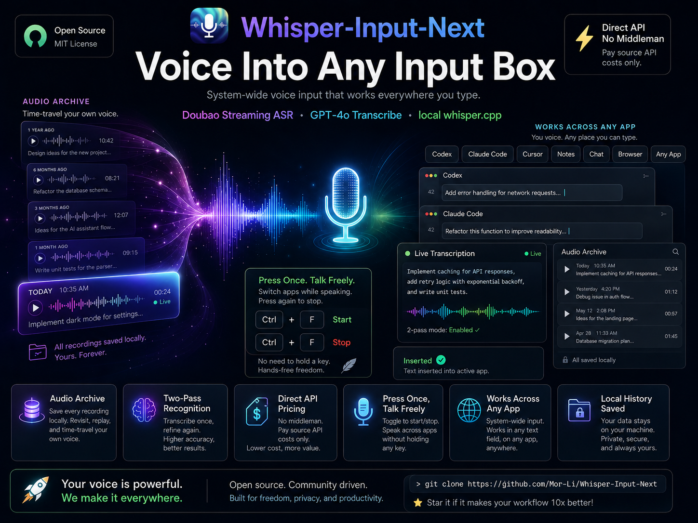
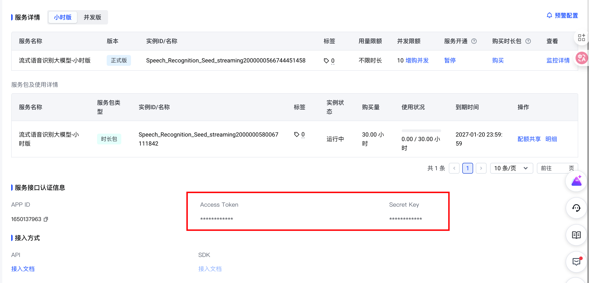
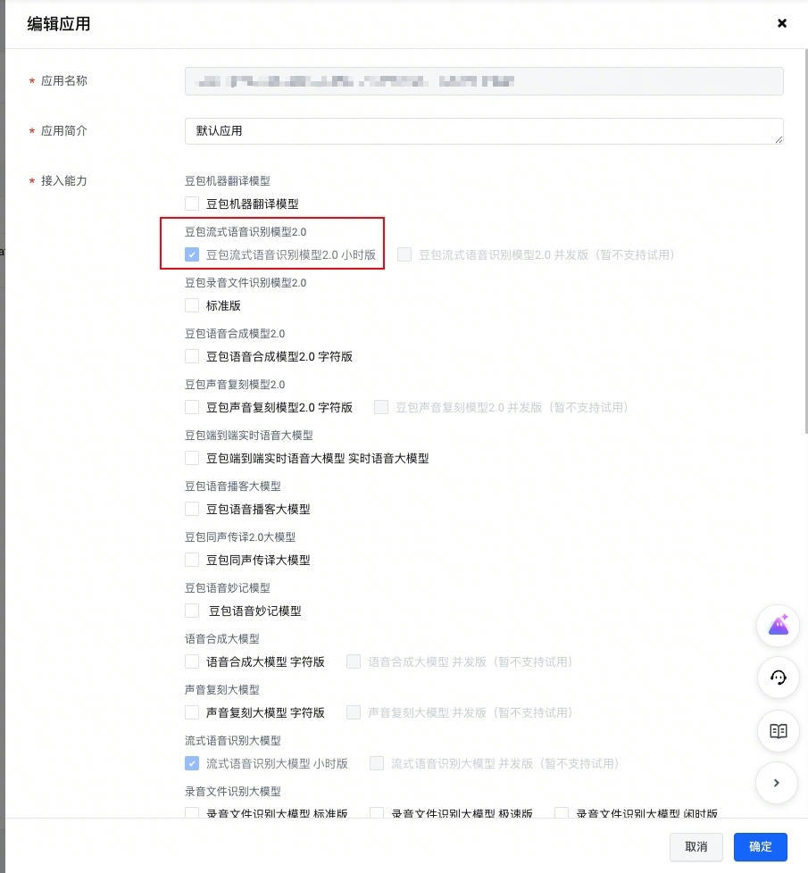

# Whisper-Input-Next - Enhanced Voice Transcription Tool

<p align="center">
  
</p>

<p align="center">
  <a href="./docs/[V3.1.0]_VERSION_CONTROL.md">
    
  </a>
  <a href="https://www.python.org/">
    
  </a>
  <a href="LICENSE">
    
  </a>
  <a href="docs/README_zh-CN.md">
    
  </a>
</p>

An intelligent voice-to-text tool that turns your speech into text in **any input box, anywhere on your system** — Cursor, Claude Code, Codex, Gemini, your browser, Slack, Notes, you name it. It's not tied to any single app.

## 🌟 Why Whisper-Input-Next?

- **🖐️ True hands-free, press-once toggle** — Tap `Ctrl+F` once and it just keeps listening. Switch windows, scroll through docs, grab something from another app, then come back — the recording never stops. No need to hold a key down the whole time (like Typeless does), so both your hands stay free and your workflow is never interrupted.
- **🌍 Works everywhere** — It types straight at your cursor in *any* app or input field, not just one editor. Code in Cursor / Claude Code / Codex, chat with Gemini, write an email — same hotkey, every box.
- **🕰️ Audio Archive = a time machine for your voice** — Every recording is saved locally, forever. Open it a year from now and literally hear what you were building last June. It's your own spoken history, kept private on your own disk — there's something almost magical about traveling back to hear your past self.
- **💸 No middleman, ever** — You pay the source vendors' APIs directly (Doubao / OpenAI), at cost. Top up a few bucks and it lasts for months. We take **$0** — no subscription, no markup, nobody skimming in the middle.
- **🎯 Two-pass recognition** — During speech pauses a higher-accuracy non-streaming model re-recognizes each sentence, noticeably improving quality (e.g. "广告位" → "光标位置").
- **🔌 Your choice of engine** — Doubao Streaming ASR (default, super cheap), OpenAI GPT-4o transcribe, or fully offline local whisper.cpp.

> 🐧 **Linux users:** Linux desktop support lives on the [`linux` branch](https://github.com/Mor-Li/Whisper-Input-Next/tree/linux), kindly contributed and maintained by [@MiaoDX](https://github.com/MiaoDX) — many thanks! I'm on macOS and don't personally test/maintain the branch, so it may lag behind `main`. Track or contribute there.

## 💰 Why Pay $12/Month? Use Open Source Instead!

**Typeless charges $12/month** for their voice keyboard, but you know what? This open-source project does the same thing for **FREE** - you only pay for the underlying API costs (Doubao ASR or OpenAI GPT-4o transcribe), which is incredibly cheap compared to Typeless's subscription.

- Typeless: $144/year subscription, **press-and-hold to talk** (ties up a hand, awkward to switch windows mid-sentence), and you don't own the service
- **Whisper-Input-Next**: **$0** + only pay for what you use (Doubao streaming ASR is super cheap!), **press-once hands-free toggle**, works in **every app system-wide**, and all your audio stays **archived on your own machine**

Stop renting your tools. Own them.

## 🚀 Project Background

This project is based on [ErlichLiu/Whisper-Input](https://github.com/ErlichLiu/Whisper-Input) for secondary development. The original project has been inactive for months, so we have made extensive feature expansions and architectural optimizations, adding important features like OpenAI GPT-4o transcribe integration, audio archiving, local whisper support, and more. [Why use this project?](./docs/[V3.0.0]_知乎blog.md)

## ✨ Key Features

### 🔥 NEW in v3.3.0: Two-Pass Recognition & Accuracy Boost
- **Two-Pass Recognition**: Enables `enable_nonstream` for sentence-level re-recognition using the higher-accuracy nostream model during speech pauses, significantly improving transcription quality
- **Deferred Text Output**: All text stays in floating preview during recording; final text is pasted only after recording stops, allowing full ASR context optimization
- **DJI Wireless Mic Support**: Auto-detects and prioritizes DJI Wireless Microphone as input device

### Doubao Streaming ASR (since v3.2.0)
- **Real-time Streaming Transcription**: Powered by ByteDance's Doubao Seed ASR 2.0, transcription appears as you speak
- **Floating Preview Window**: Shows pending text in real-time near your input field, like an IME
- **Now Default for Ctrl+F**: The best voice input experience, set as default (configurable)
- 👉 [How to get your API keys](#how-to-get-doubao-api-keys)

### 🎯 Core Functions
- **Multi-platform Transcription Services**: Doubao Streaming ASR (default), OpenAI GPT-4o transcribe, local whisper.cpp
- **Smart Hotkeys**: Ctrl+F (Doubao streaming, default) / Ctrl+I (local cost-saving mode)
- **Audio Archive**: Automatically save all recordings, support history playback
- **Failure Retry**: Intelligent error handling and retry mechanism

### 🔧 Technical Features
- **Dual Processor Architecture**: Streaming + Batch processors working simultaneously
- **180s Long Audio Support**: Support up to 3 minutes of continuous recording
- **Smart Status Indicators**: Simple numeric status display (0, 1, !)
- **Cache System**: Audio archive with transcription result caching
- **Cursor-safe hotkeys** *(macOS)*: The recording hotkey is intercepted at the Quartz event-tap layer so toggling never nudges your text caret (`Ctrl+F`/`Ctrl+I` no longer trigger the built-in forward-char/Tab), enabling precise mid-text insertion — adapts automatically to whatever hotkey you configure. [Details](./docs/HOTKEY_CURSOR_FIX.md)

### 🌟 User Experience
- **No Clipboard Pollution**: Clean status display without interfering with system clipboard
- **One-click Retry**: Failed transcriptions can be retried without re-recording
- **Real-time Input**: Transcription results appear directly at cursor position
- **Privacy Protection**: Local processing option, data not uploaded

## 📦 Quick Start

### Environment Requirements
- Python 3.12+
- macOS/Linux (Windows support in development)
- Network connection (only required for cloud services)
- **Local whisper.cpp** (required when using local transcription features)

### Installation Steps

1. **Clone Project**
```bash
git clone https://github.com/Mor-Li/Whisper-Input-Next.git
cd Whisper-Input-Next
```

2. **Install Dependencies** (requires [uv](https://docs.astral.sh/uv/))
```bash
uv sync
```

3. **Install Local whisper.cpp4. **Install Local whisper.cpp (Optional, required for local transcription)**
```bash
# Clone whisper.cpp repository
git clone https://github.com/ggerganov/whisper.cpp.git
cd whisper.cpp

# Compile (macOS/Linux)
make

# Download model file (recommend large-v3)
bash ./models/download-ggml-model.sh large-v3

# Record whisper-cli path for later configuration in .env file
echo "Whisper CLI Path: $(pwd)/build/bin/whisper-cli"
cd ..
```

4. **Configure Environment Variables**
```bash
cp env.example .env
# Edit .env: configure Doubao or OpenAI keys (at least one), see the Configuration Guide below
```

5. **Run Program**
```bash
./start.sh            # runs in a tmux session and attaches to it
./start.sh --detach   # runs in the background only
```

`start.sh` runs `scripts/supervise.sh` inside the tmux session `Whisper-Input-Next`. The supervisor restarts `main.py` whenever it exits abnormally. One known case: macOS CoreAudio sometimes never returns from stopping the microphone stream, after which no new recording can start in that process. The app detects this, waits for any in-flight transcription to finish, and exits with code 75 so the supervisor brings it back within a few seconds. Logs go to `logs/Whisper-Input-Next-<timestamp>.log`, and `logs/latest.log` points to the current run.

6. **Start automatically at login (optional)**
```bash
./scripts/install_autostart.sh            # install a LaunchAgent
./scripts/install_autostart.sh uninstall  # remove it
```
When started this way, macOS attributes microphone and Accessibility permissions to `tmux` rather than your terminal app. If the hotkey does nothing after a reboot, enable `tmux` under System Settings → Privacy & Security → Accessibility and Microphone.

### ⚠️ Important Notes

**Required Configuration:** Doubao keys (`DOUBAO_APP_KEY`, `DOUBAO_ACCESS_KEY`) or `OFFICIAL_OPENAI_API_KEY`. `WHISPER_CLI_PATH` and `WHISPER_MODEL_PATH` are only needed for local transcription with Ctrl+I.

**whisper.cpp Installation Guide:**
1. Clone and compile from [whisper.cpp repository](https://github.com/ggerganov/whisper.cpp)
2. Download large-v3 model: `bash ./models/download-ggml-model.sh large-v3`
3. Configure correct paths in .env

## ⚙️ Configuration Guide

### Environment Variable Configuration

Configure the following parameters in the `.env` file:

```bash
# ============ Doubao Streaming ASR (Recommended, Default) ============
# Get your API keys from Volcengine Console (see screenshot below)
DOUBAO_APP_KEY=your_app_id_here        # APP ID from console
DOUBAO_ACCESS_KEY=your_access_token_here  # Access Token from console

# Transcription service for Ctrl+F: "doubao" (default, streaming) or "openai" (batch)
TRANSCRIPTION_SERVICE=doubao

# ============ OpenAI (fallback when Doubao is not configured) ============
OFFICIAL_OPENAI_API_KEY=sk-proj-xxx
CONVERT_TO_SIMPLIFIED=false   # convert Traditional Chinese output to Simplified
AUTO_RETRY_LIMIT=5            # automatic retries on failure

# ============ Local whisper.cpp (Optional, for Ctrl+I) ============
WHISPER_CLI_PATH=/path/to/whisper.cpp/build/bin/whisper-cli
WHISPER_MODEL_PATH=models/ggml-large-v3.bin

# ============ Hotkeys ============
HOTKEY_MODIFIER=ctrl          # modifier + f / modifier + i
TRANSCRIPTIONS_BUTTON=f
SYSTEM_PLATFORM=mac           # mac (Cmd+V to paste) / win (Ctrl+V)
```

At least one of Doubao or OpenAI must be configured. See `env.example` for the full template.

<a id="how-to-get-doubao-api-keys"></a>
**How to get Doubao API keys**:

1. Go to [Volcengine Console - Speech Recognition](https://console.volcengine.com/ark/region:ark+cn-beijing/tts/speechRecognition)
2. Find your **APP ID** and **Access Token** in the "服务接口认证信息" section (see screenshot below)

<p align="center">
  
</p>

**Important Notes**:
- **Doubao Streaming ASR** is now the default and recommended transcription service
- Set `TRANSCRIPTION_SERVICE=openai` to use OpenAI batch mode instead

### 🐛 Troubleshooting (Common Pitfalls)

#### Doubao streaming ASR fails with `403` on connect

If recording starts but you immediately see something like:

```
ERROR - 连接豆包 ASR 失败: 403, message='Invalid response status', url='wss://openspeech.bytedance.com/api/v3/sauc/bigmodel_async'
ERROR - ❌ Doubao streaming error: connection failed
```

**This is almost always a missing capability on your Volcengine app, NOT a bug in the code or a wrong endpoint.** The `403` is returned during the WebSocket **handshake** (at the gateway, before authentication), which is the tell-tale sign that the `X-Api-Resource-Id` your key requests is not enabled for your app.

This project uses the resource id `volc.seedasr.sauc.duration`, which maps to **豆包流式语音识别模型 2.0 · 小时版 (Doubao Streaming Speech Recognition Model 2.0 · Hourly)**. You must explicitly enable that exact capability:

1. Open the Volcengine console: [https://console.volcengine.com/speech/app](https://console.volcengine.com/speech/app)
2. Find your app and click **编辑应用 (Edit Application)**.
3. Under **接入能力 (Access Capabilities)**, locate **豆包流式语音识别模型 2.0** and check **豆包流式语音识别模型 2.0 小时版** (the box highlighted below).
4. Save, then run the program again.

<p align="center">
  
</p>

> **Note**: Do NOT "fix" this by downgrading the resource id to the older `volc.bigasr.sauc.*` namespace. The `volc.seedasr.sauc.duration` (2.0) endpoint is correct — the fix is enabling 2.0 on the console, not changing the code. Enabling 1.0 only masks the real permission problem and gives you a lower-accuracy model.

### Quick Start with Aliases (Recommended)

Add these aliases to your shell profile (`~/.bashrc`, `~/.zshrc`, etc.):

```bash
alias whisper_input='cd /path/to/Whisper-Input-Next && ./start.sh'
alias whisper_input_off='tmux kill-session -t Whisper-Input-Next'
```

Replace `/path/to/Whisper-Input-Next` with your actual project path.

### Hotkey Instructions

| Hotkey | Function | Service | Features |
|--------|----------|---------|-----------|
| `Ctrl+F` | **Real-time streaming transcription** | Doubao Seed ASR 2.0 (default) | Ultra-low latency, floating preview, text appears as you speak |
| `Ctrl+I` | Local transcription | whisper.cpp | Offline processing, privacy protection |

> **Note**: Set `TRANSCRIPTION_SERVICE=openai` in `.env` to use OpenAI GPT-4o transcribe instead of Doubao for Ctrl+F.

### Status Indicators

The menu bar icon shows the current state: idle, recording, or transcribing. Warnings and errors show there for two seconds. In Doubao mode a floating window previews the text while you speak. The final text is pasted at the cursor after you stop. Failed OpenAI transcriptions are retried automatically from the saved audio.

Click the menu bar icon to see usage: transcriptions today, in the last 7 and 30 days, all-time totals, a bar chart of the last 30 days, and a Quit item. The numbers come from the transcription cache `audio_archive/cache.json`.

## 📚 Feature Documentation

**Features**

- [🔊 Audio Archive & Transcription Cache](./docs/[V3.0.0]_AUDIO_ARCHIVE_FEATURE.md) - *v3.0.0, hardened in v3.3.1*
- [🛡️ Transcription Cache Data Safety](./docs/TRANSCRIPTION_CACHE_SAFETY.md) - *v3.3.1* — why the cache can no longer wipe itself, and how to rescue it if it ever does
- [⚡ Async Transcription Queue](./docs/[V3.2.0]_ASYNC_TRANSCRIPTION_QUEUE.md) - *v3.2.0*
- [🔔 Audio Device Disconnect Notification](./docs/device_notification.md)
- [🖥️ macOS Status Bar Indicator](./docs/[V3.3.0]_STATUS_BAR.md) - *v3.3.0*

**macOS hotkey pitfalls**

- [🖱️ Cursor Drift Fix](./docs/HOTKEY_CURSOR_FIX.md) — why `Ctrl+F`/`Ctrl+I` no longer nudge your caret
- [🔧 Dead Event-Tap Self-Heal](./docs/HOTKEY_DEAD_TAP_SELFHEAL.md) - *v3.3.1* — read this first when hotkeys suddenly stop responding

**Project background**

- [📋 Version Control Documentation](./docs/[V3.1.0]_VERSION_CONTROL.md) - *v3.1.0*
- [📝 Release Notes v3.1.0](./docs/[V3.1.0]_RELEASE_NOTES.md)
- [✍️ Why This Project (Chinese blog post)](./docs/[V3.0.0]_知乎blog.md)

**Deprecated**

- [📄 Upstream Project README (archive)](./docs/[DEPRECATED]_README_upstream.md)

## 🛠️ Development Status

### ✅ Completed Features
- [x] **Two-pass recognition for higher accuracy** *(NEW in v3.3.0)*
- [x] **Deferred text output with full-context optimization** *(NEW in v3.3.0)*
- [x] **DJI Wireless Mic auto-detection** *(NEW in v3.3.0)*
- [x] **Doubao Streaming ASR integration** *(v3.2.0)*
- [x] **Floating preview window for real-time feedback** *(v3.2.0)*
- [x] OpenAI GPT-4o transcribe integration
- [x] Audio archive system
- [x] Local whisper support
- [x] Dual processor architecture
- [x] Smart retry mechanism
- [x] Project documentation improvement
- [x] 10-minute recording limit protection
- [x] Status indicator delay optimization
- [x] Audio format conversion support (m4a to wav)
- [x] Bilingual documentation system
- [x] GPT-4o terminology standardization

### 🚧 In Development  
*No features currently in development*

### 📋 Planned Features
*No features currently planned*

### 🧪 Experimental Features History

#### iOS Keyboard Extension Experiment (August 14, 2025)
**Status**: ❌ Discontinued due to Apple's restrictions  
Attempted to create iOS keyboard extension but discovered that even Sogou Input Method cannot directly record audio in keyboard extensions due to Apple's system limitations. iOS voice input is currently not feasible as a seamless keyboard extension.

## 🤝 Contributing Guidelines

We welcome all forms of contributions! Whether it's:

- 🐛 **Bug Reports**: Found an issue? [Create an Issue](https://github.com/Mor-Li/Whisper-Input-Next/issues)
- 💡 **Feature Suggestions**: Have great ideas? [Start a Discussion](https://github.com/Mor-Li/Whisper-Input-Next/discussions)
- 📝 **Code Contributions**: Submit Pull Requests
- 📚 **Documentation Improvements**: Help improve documentation
- 🌍 **Translations**: Help translate to more languages

### Development Environment Setup

```bash
git clone https://github.com/Mor-Li/Whisper-Input-Next.git
cd Whisper-Input-Next
uv sync                 # creates .venv from pyproject.toml / uv.lock
.venv/bin/python -m unittest discover -s test -p "test_*.py"
./start.sh
```

`test/` holds automated tests that use fakes only. `test/manual/` holds scripts that need a real microphone or real API keys. `tools/` holds standalone transcription scripts for audio files.

## 🙏 Acknowledgments

- Thanks to [ErlichLiu/Whisper-Input](https://github.com/ErlichLiu/Whisper-Input) for the original project foundation
- Thanks to [ByteDance/Volcengine](https://www.volcengine.com/) for the excellent Doubao Seed ASR 2.0 streaming API
- Thanks to OpenAI for providing excellent transcription API services
- Thanks to [whisper.cpp](https://github.com/ggerganov/whisper.cpp) community for local processing support
- Thanks to all contributors and users for their support

## 📞 Contact Information

- **Project Address**: https://github.com/Mor-Li/Whisper-Input-Next  
- **Issue Reports**: [Issues](https://github.com/Mor-Li/Whisper-Input-Next/issues)
- **Feature Suggestions**: [Discussions](https://github.com/Mor-Li/Whisper-Input-Next/discussions)

## 📋 Changelog

### v3.4.0 (2026-11-19)
- **Fix the "spinning forever" freeze**: when macOS CoreAudio hangs while stopping the microphone, the app now restarts itself instead of staying stuck
- **Supervisor and start at login**: `start.sh` runs the app under a restart loop, `scripts/install_autostart.sh` installs a LaunchAgent
- **Cleanup**: removed unreachable features (translation mode, Kimi polish, GROQ/SiliconFlow, punctuation post-processing, PyQt control panel). They remain available at git tag `pre-cleanup-2026-11`
- **Usage stats in the menu bar**: click the icon to see daily transcription counts and a 30-day bar chart
- Dependencies moved to `pyproject.toml` + `uv.lock`

### v3.3.0 (2026-03-11)
- **Two-pass recognition**: Enable `enable_nonstream` for sentence-level re-recognition with nostream model, significantly improving accuracy (e.g. "广告位" → "光标位置")
- **Deferred text output**: All text stays in floating preview during recording; final text pasted only after stop, allowing full ASR context optimization
- **DJI Wireless Mic support**: Auto-detect and prioritize DJI Wireless Microphone as highest priority input device
- **Lower latency**: Reduce streaming chunk size from 200ms to 100ms
- **Faster streaming**: Remove artificial delays in audio packet sending

### v3.2.0 (2025-07-27)
- **Doubao Streaming ASR**: Real-time streaming transcription powered by ByteDance Seed ASR 2.0
- **Floating preview window**: Shows pending text in real-time near input field
- **Auto audio device switching**: Priority-based microphone selection

### v3.0.0
- OpenAI GPT-4o transcribe integration
- Audio archive system
- Local whisper.cpp support
- Dual processor architecture

---

**⭐ If this project helps you, please give it a Star for support!**